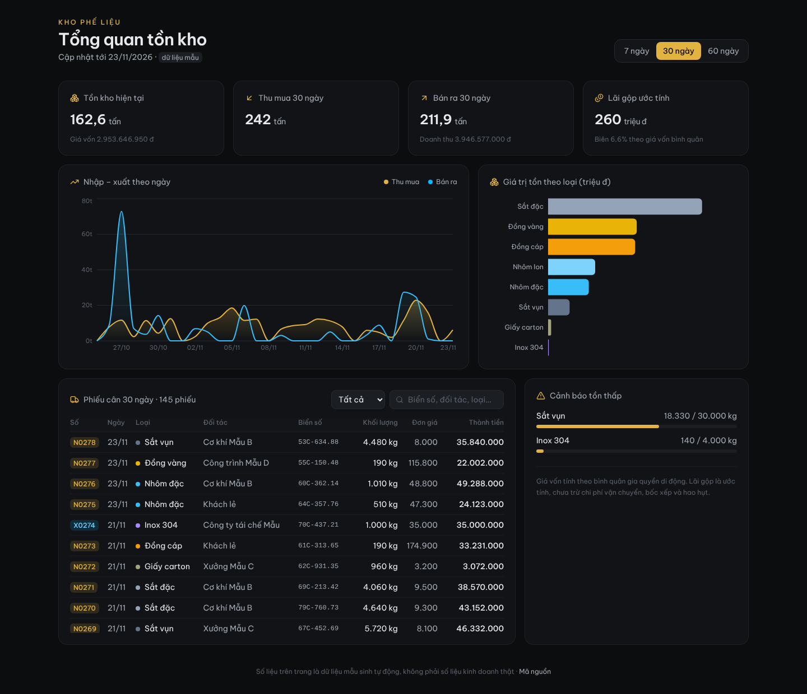

# scrap-inventory-dashboard

[](https://github.com/ferbdev-byte/scrap-inventory-dashboard/actions/workflows/ci.yml)


Dashboard **tồn kho phế liệu** cho vựa và công ty thu mua. Trang hiển thị bao nhiêu tấn đang nằm trong kho, vốn đang nằm ở loại nào, thu mua và bán ra theo ngày, lãi gộp ước tính, và loại nào sắp hết.

**[▶ Xem demo trực tiếp](https://ferbdev-byte.github.io/scrap-inventory-dashboard/)**



<sub>Số liệu trên demo là **dữ liệu mẫu** sinh tự động (hạt giống cố định). Đây không phải số liệu kinh doanh thật.</sub>

## Tính năng

- **4 chỉ số chính**: tồn kho (tấn và giá vốn), thu mua, bán ra kèm doanh thu, lãi gộp ước tính kèm biên lãi. Đổi kỳ 7 / 30 / 60 ngày.
- **Biểu đồ nhập – xuất theo ngày** và **giá trị tồn theo loại**, giúp thấy ngay vốn đang bị chôn ở đâu.
- **Bảng phiếu cân**: lọc thu mua/bán ra, tìm theo biển số, đối tác hoặc loại hàng.
- **Cảnh báo tồn thấp** theo ngưỡng riêng của từng loại.
- **Giá vốn bình quân gia quyền di động**: lãi gộp tính theo giá vốn *tại thời điểm bán*, không lấy giá cuối kỳ.
- **Nhập phiếu cân từ file**: kéo file `.jsonl` do [weighbridge-reader](https://github.com/ferbdev-byte/weighbridge-reader) ghi ra từ đầu cân, tự nhận loại hàng theo tên viết tự do, trừ tạp chất, báo lỗi từng dòng. Chặn trường hợp xuất quá tồn.
- **Giao diện sáng / tối**: theo cài đặt hệ điều hành, nhớ lựa chọn của bạn.
- **Tải nhanh**: phần biểu đồ được tách ra tải sau (`React.lazy`), bundle chính chỉ ~78 KB gzip.
- Dùng được trên điện thoại (bảng cuộn ngang, không vỡ layout).

## Kiến trúc

```
src/
├── lib/
│   ├── inventory.ts       ← logic thuần: tồn kho, giá vốn, dòng nhập–xuất, KPI (không phụ thuộc React)
│   ├── inventory.test.ts  ← test Vitest cho logic
│   ├── importJsonl.ts     ← đọc phiếu cân JSON Lines (+ test)
│   └── sample.ts          ← sinh dữ liệu mẫu có hạt giống cố định
├── components/Charts.tsx  ← biểu đồ Recharts, tải lười
├── App.tsx                ← giao diện (Tailwind v4 + lucide-react)
└── index.css              ← theme
```

Logic tính toán tách hẳn khỏi giao diện, nên muốn nối dữ liệu thật thì chỉ cần thay `sampleTxns()` bằng dữ liệu từ API hoặc từ file phiếu cân của [weighbridge-reader](https://github.com/ferbdev-byte/weighbridge-reader).

Test bao gồm: giá vốn bình quân, xuất không làm đổi giá vốn, chặn xuất quá tồn, giao dịch không theo thứ tự ngày, lãi gộp, ngưỡng cảnh báo, và dữ liệu mẫu không bao giờ âm kho.

## Chạy

```bash
npm install
npm run dev      # http://localhost:5173
npm test         # Vitest
npm run build    # ra thư mục dist/
```

Mỗi lần push lên `main`, GitHub Actions chạy lint, test và build, rồi deploy lên GitHub Pages.

## Giấy phép

MIT
